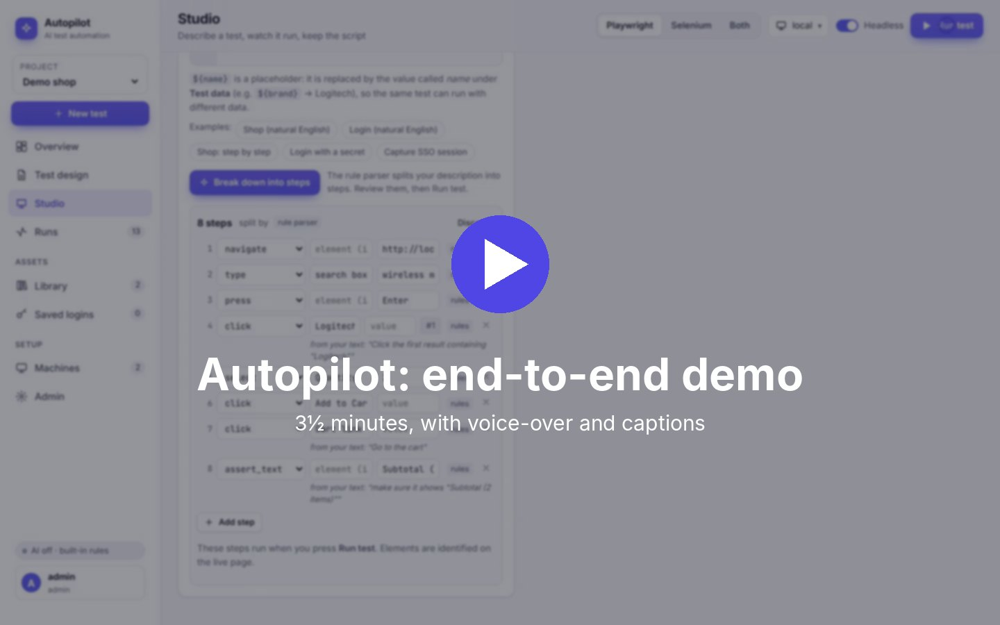
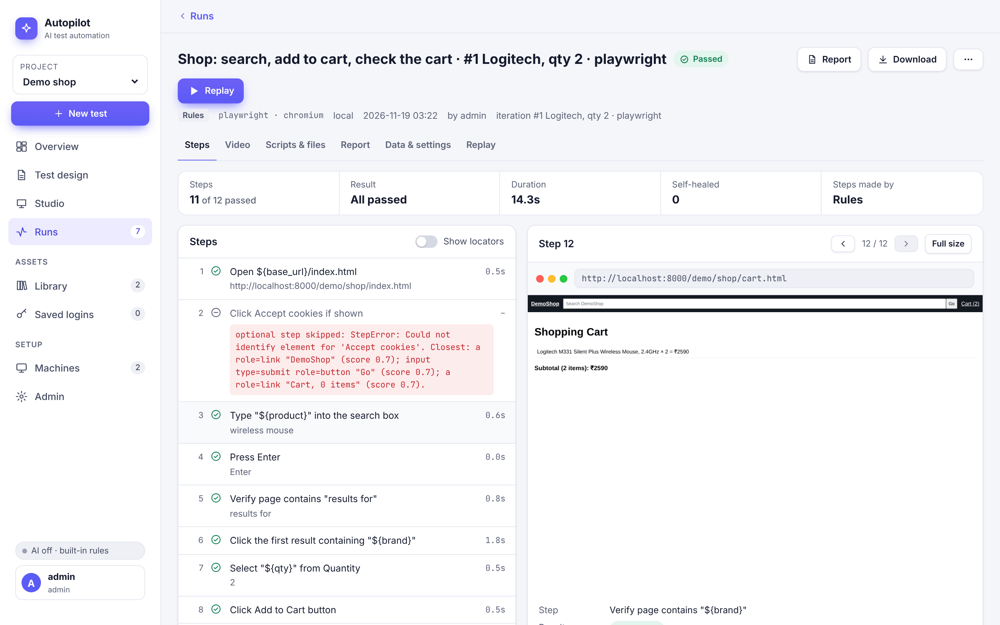
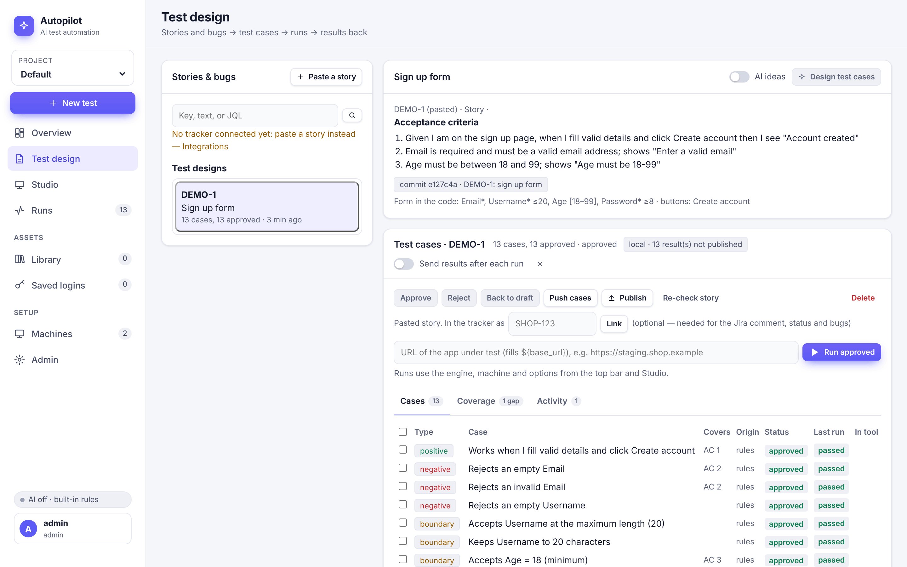
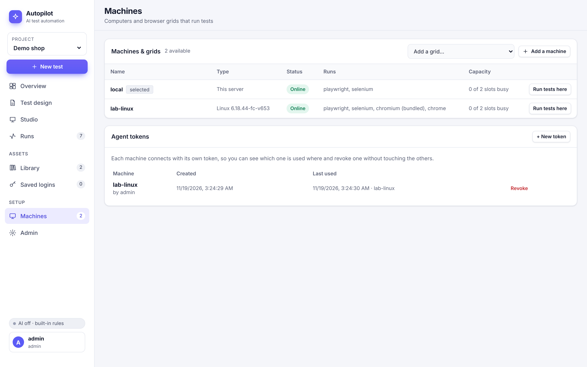

# Autopilot: AI test automation

Write a browser test in plain English, or paste the business scenario as a paragraph, with no quotes and no step format. Autopilot works out each step's **intent** (click, type, select, hover,
drag, check…) and **value**, finds the element on the live page, and runs it with **Playwright or Selenium** using
each engine's native locators. Every run leaves a **report, a video, screenshots, and a plain Playwright / Selenium
script** you can replay on any engine, browser or machine, or take away as a standalone project, with no AI involved.

```
 plain English + test data ──► first run ──────────► generated script ──► replays (Script mode) ──► …
   (web app / CLI / API)        finds each element    native locators      fast, no AI, self-heals
                                live view, video,     test_playwright.py   when the page changes
                                report, screenshots   test_selenium.py     → exported project, CI
```

[](docs/media/demo/e2e-demo.mp4)

**[▶ End-to-end demo with voice-over (3:39)](docs/demo.md)**: chapters, transcript and captions on the [demo page](docs/demo.md).

[](docs/media/videos/studio-run.mp4)

| Every run: steps, screenshots, locators | Test design from a story | Hub + agents on any OS |
|---|---|---|
|  |  |  |

More in the **[feature tour](docs/features.md)** (screenshots and recordings of every page).

**AI is optional.** Built-in rules and heuristics run everything; AI (your Claude, Cursor or Copilot subscription,
an API key, or any model through LiteLLM) helps with free-form descriptions, look-alike elements and canvas.

## Quick start

You need **Python 3.11+**. In the repository folder:

| macOS / Linux | Windows |
|---|---|
| `./setup.sh --demo` | `setup.bat --demo` |
| `./start.sh` | `start.bat` |

Open **http://localhost:8000** and sign in as **admin / autopilot-demo**.

`--demo` fills the database with real demo data: three accounts (admin, tester, viewer), two projects and 20 runs
with reports, videos and scripts, including a test design that catches a planted bug. Leave it out to start empty: the
hub then prints a one-time setup code to create your admin account. Practice pages to test against are served at
**http://localhost:8000/demo/**.

Docker instead: `docker compose up --build`. Full instructions: **[Getting started](docs/getting-started.md)**.

## What's in it

- **Studio**: write the test, give it data (single run or a grid of iterations, each with its own browser), watch it
  run live with every element highlighted, edit the steps.
- **Both engines, every browser**: Playwright and Selenium side by side; Chromium, Chrome, Edge, Firefox, WebKit,
  Safari; visible or headless.
- **Hard pages**: shadow roots (also closed), nested and cross-origin iframes, late and virtualised content, dialogs,
  drag and drop, custom-skinned controls, look-alike buttons. Ties are never guessed silently.
- **Replay and self-healing**: replays run the stored native locators; a broken one is repaired from the step's
  description and a new script is written.
- **Generated scripts and exported projects** that run anywhere with only Playwright or Selenium installed, with
  their own report, video and JUnit XML.
- **Secrets masked everywhere**: live view, screenshots, video, reports, scripts.
- **Machines**: the hub plus any number of Windows, macOS and Linux agents and browser grids, with parallel slots.
- **Team platform**: accounts, SSO (OpenID Connect), roles, projects, each person's own AI.
- **Test design**: from a Jira / Azure DevOps story (or a pasted one) and its code, rule-based positive, negative and
  boundary cases; results back to Zephyr Scale, Xray, Azure DevOps and Jira (comment, transition, bugs).
- **Your data in SQLite**, with ready-made reporting views for SQL, spreadsheets and dashboards.

## Documentation

| | |
|---|---|
| [Getting started](docs/getting-started.md) | Install, sign in, first test, replay, export |
| [End-to-end demo](docs/demo.md) | 3½-minute narrated walkthrough of every feature, with chapters and transcript |
| [Feature tour](docs/features.md) | Screenshots and recordings of every feature |
| [Deployment](docs/deployment.md) | Every mode: one computer, Docker, team server, agents on Windows / macOS / Linux / Docker, grids, HTTPS |
| [User guide](docs/user-guide.md) | Writing tests, data and iterations, runs, replay, scripts, logins, accounts |
| [Chrome extension](docs/chrome-extension.md) | Paste a scenario or record a flow on the page you have open; it runs right there, following new tabs |
| [Architecture](docs/architecture.md) | The parts, the life of a run, element finding, AI, security, code map |
| [All diagrams](docs/diagrams.md) | Every block diagram in one place (20) |
| [Database](docs/database.md) | Demo data, tables, reporting views, example SQL, backup |
| [Integrations](docs/integrations.md) | Jira, Confluence, GitHub, local Git, Zephyr Scale, Xray, Azure DevOps |
| [Machines and Docker](docs/machines.md) | Agents, Windows and macOS, grids, Docker, hosting for a team |
| [Configuration](docs/configuration.md) | Environment variables |
| [API](docs/api.md) | REST endpoints, live events, CI example |
| [Development](docs/development.md) | Web app, tests, real-website suite, CI |
| [Troubleshooting](docs/troubleshooting.md) | Common problems |

## Command line

```bash
python -m aiauto server --port 8000                       # web app + hub
python -m aiauto run -f examples/shop_cart.txt --data examples/shop_data.json --engine selenium
python -m aiauto replay artifacts/<run>/test_playwright.py --engine selenium --data new.json
./agent.sh --server http://HUB:8000 --token <token> --slots 2   # Windows: agent.bat
python -m aiauto demo                                     # demo data
```

## Tested on

Windows, macOS and Linux in CI, including a suite of eight scenarios on real public practice websites, run with
visible browsers and AI off: first run, replay of the generated script, and the exported project on its own, on
Playwright and Selenium with Chrome, Edge, Firefox, WebKit and Safari. See [Development](docs/development.md#ci).
