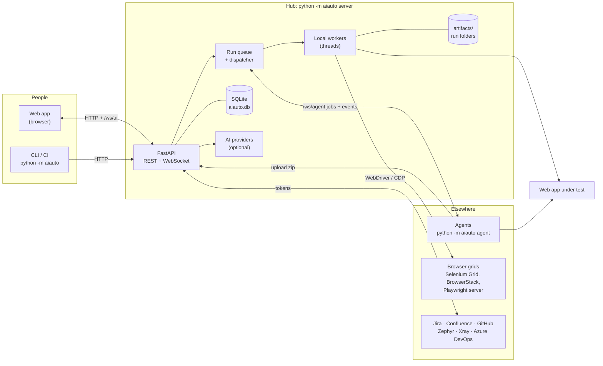
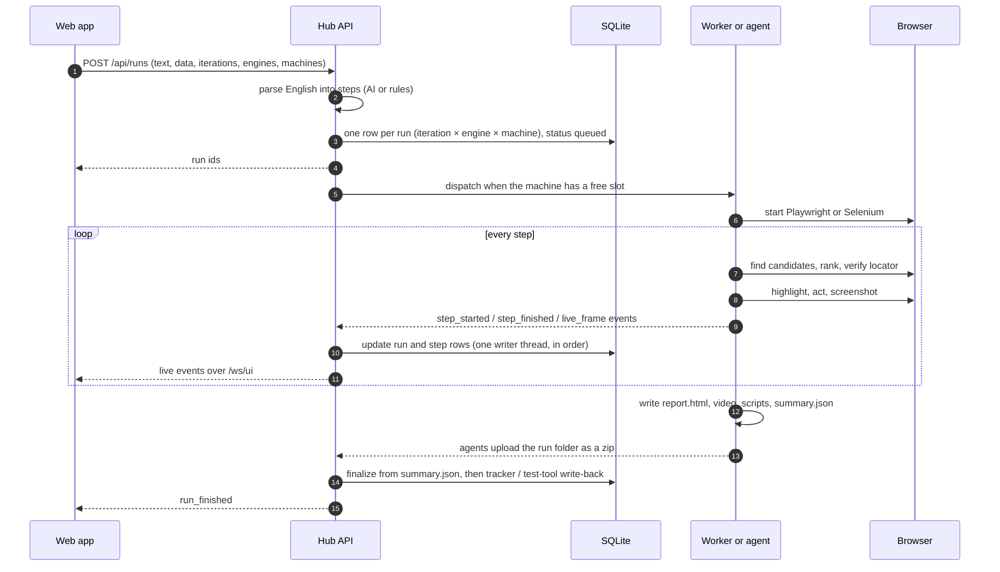
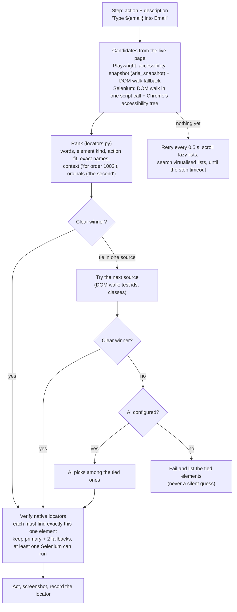
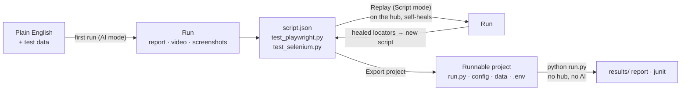
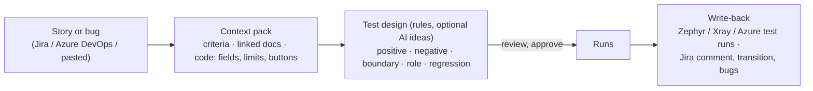

# Architecture

How Autopilot is put together, and what happens when you press **Run**. Read [Getting started](getting-started.md)
first if you haven't run it yet.

- [The big picture](#the-big-picture)
- [The parts](#the-parts)
- [Life of a run](#life-of-a-run)
- [Finding the element for a step](#finding-the-element-for-a-step)
- [AI: where it is used and where it is not](#ai-where-it-is-used-and-where-it-is-not)
- [First run, replay, generated script, exported project](#first-run-replay-generated-script-exported-project)
- [Machines: the hub, agents and grids](#machines-the-hub-agents-and-grids)
- [Storage](#storage)
- [Security model](#security-model)
- [Test design and write-back](#test-design-and-write-back)
- [Code map](#code-map)

## The big picture

Everything lives in one Python package (`aiauto`) plus a React web app (`web/`, built into the package).
One process, the **hub**, serves the web app and the API, keeps the database and runs tests. Other computers can join
as **agents** to run tests too.



## The parts

| Part | What it does | Where |
|---|---|---|
| **Web app** | Overview, Test design, Studio, Runs, Library, Saved logins, Machines, Admin, My AI. Talks only to the hub's API and the `/ws/ui` live feed | `web/src` (React + Vite), built into `aiauto/server/static/app` |
| **Hub** | Web server, REST API, sign-in, run queue, dispatcher, local workers, live-event fan-out, database writer | `aiauto/server/app.py`, `auth.py`, `integrations_api.py` |
| **Parser** | Plain English → steps (action, target, value, ordinal, optional). AI if configured, else built-in rules | `aiauto/nlp/parser.py`, `rules.py`, `prose.py`, `llm.py` |
| **Runner** | Executes one test on one engine: resolves elements, acts, checks, records, writes artifacts | `aiauto/runner.py` |
| **Engines** | Playwright and Selenium behind one interface: start a browser, snapshot candidates, verify locators, act, screenshot, video | `aiauto/engines/` |
| **Locator scoring** | Ranks candidate elements against a step's words, kind and context; builds native locators | `aiauto/locators.py` |
| **Script generator** | Turns a finished run into `test_playwright.py` / `test_selenium.py` with native locators | `aiauto/scriptgen.py` |
| **Script runtime** | The small standalone library the generated scripts import (`autopilot_runtime.py`): browser start, highlight, screenshots, video, report | `aiauto/script_runtime.py` |
| **Report / export** | `report.html` per run; a runnable project zip for a run or a batch | `aiauto/report.py`, `aiauto/export.py` |
| **Agent** | Joins a hub over an outbound WebSocket, runs jobs with its own browsers, streams events, uploads artifacts | `aiauto/agent.py` |
| **Integrations** | Trackers, docs, code and test tools over tokens; context packs; rule-based test design; write-back | `aiauto/integrations/` |
| **Database** | SQLite: runs, steps, users, projects, library, logins, designs, connections, machines; reporting views | `aiauto/db.py` (see [Database](database.md)) |

## Life of a run



1. **Submit.** The web app (or the CLI, or CI through the API) posts the test: plain English, already-edited steps, a
   library script, or `replay_run_id` for a replay. With it come the data, iterations, engine(s), browser, options
   and target machines.
2. **Parse.** On the hub, `nlp/parser.py` turns the English into `Step`s. With an AI provider configured, the AI reads
   the whole description; otherwise the rule parser splits prose into clauses and expands common intents ("log in",
   "add to cart", "make sure it shows"). `${name}` placeholders stay in the steps and are filled per iteration.
3. **Fan out.** One run is created per iteration × engine × machine (3 iterations × both engines × 2 machines = 12 runs).
   Each gets a row in `runs` with status `queued` and the same `batch_id`.
4. **Dispatch.** `_pump()` walks the queue in order and starts each job on the least-loaded machine it may use that
   has a free slot: the hub's own worker threads (`AIAUTO_LOCAL_WORKERS`), a browser grid (the hub drives the remote
   browser), or an agent (sent as a `job` message). Runs wait as `queued` until a slot frees up.
5. **Execute.** The runner opens the browser and, step by step, substitutes the data, finds the element, shows the
   highlight box, acts, waits for the page to settle and takes the step screenshot. Every change is an event.
6. **Live.** Events go to the hub, which writes them to SQLite on a single writer thread (so a run's updates never apply
   out of order) and forwards them to the browsers watching that project. `live_frame` and `step_shot` are streamed
   but never stored.
7. **Finish.** The runner writes the run folder (report, video, scripts, `summary.json`). Agents upload it as a zip.
   The hub then makes the database match `summary.json` (the authoritative record) and, if the run came from a test
   design, sends results to the connected tools.

A run's status moves `queued → dispatched → running → passed | failed | cancelled`. Runs that were in flight when the
hub stopped become `interrupted` on the next start.

## Finding the element for a step

This is the core of the tool. For each step that targets an element, at the moment the step runs:



- **Candidates.** Playwright's accessibility snapshot gives real roles and accessible names, shadow DOM and iframes. A
  DOM walk covers what has no role (custom-skinned controls, plain `div`s). Selenium uses one in-page script for the
  DOM walk (so a step costs one round trip, not dozens) and refines the top candidates with Chrome's accessibility
  tree over CDP.
- **Ranking** scores each candidate on the step's words in its name, label, placeholder, test id, id and classes; on
  whether the element is the kind the step names ("button", "checkbox", "link") and fits the action (you type into a
  text box, never into its label); on context words; and on numbers, which must match exactly.
- **Locators** are native to each engine: `get_by_role("button", name="Pay now")`, `frame_locator(...)` chains,
  `By.ID`, `By.LINK_TEXT`, `shadow_root` + CSS. Each one is verified against the page before it is kept.
- **Hard cases** handled: open and closed shadow roots at any depth, nested and cross-origin iframes, late and
  re-rendered elements, virtualised lists, look-alike buttons, non-breaking spaces, canvas (AI on a screenshot).

## AI: where it is used and where it is not

| Stage | With AI | Without AI |
|---|---|---|
| English → steps | The AI reads the whole description | Rule parser |
| Which element | Heuristics; the AI breaks ties | Heuristics; a tie fails with the tied elements listed |
| Canvas / pixels only | The AI finds it on a screenshot | Fails, saying it is a canvas |
| Running a step | No AI: native engine calls | same |
| Replay, self-healing | Stored locators → fallbacks → re-identify (AI breaks ties) | same, heuristics only |
| Generated scripts, exported projects | **No AI at all** | same |
| Test design from a story | Rules; optional "AI ideas" | Rules |

Providers (`aiauto/nlp/providers.py`), tried in order on **Auto**: the Claude Code CLI you are logged into, Cursor
CLI, GitHub Copilot CLI, an Anthropic API key, any model through LiteLLM. Each person can set their own (**My AI**);
otherwise the organisation AI applies. Agents send AI calls back to the hub, which answers with the run owner's
settings, so nobody's login is used for anyone else.

Subscription mode drives the official CLI that someone installed and logged into themselves. If you build a product
on Autopilot for other people, use API keys (or LiteLLM) instead: Anthropic doesn't allow third-party products to
offer Claude.ai login without approval.

## First run, replay, generated script, exported project



- **First run** ("AI mode", even with AI off): the description is resolved against the live page.
- **Replay** ("Script mode"): the stored locators run directly; if one no longer matches, the engine tries the
  fallbacks, then re-identifies the element from the step's description, marks the step *self-healed* and writes a new
  script.
- **Generated scripts** are plain Playwright / Selenium code plus `autopilot_runtime.py`. They never self-heal: they
  pass or fail, like any hand-written test, and still produce a report, video, screenshots and `junit.xml`.
- **Exported project**: everything needed to run without the hub, for one run or every iteration of a batch.

## Machines: the hub, agents and grids

| Where a test runs | How it connects | Parallel | Good for |
|---|---|---|---|
| **The hub itself** ("local") | Worker threads in the hub process | `AIAUTO_LOCAL_WORKERS` (2) | One machine, quick start |
| **Agent** | `python -m aiauto agent --server URL` opens an **outbound** WebSocket (`/ws/agent`), so it works behind NAT and firewalls | `--slots N` | Windows / macOS / Linux machines, a headed browser on your desk, Docker boxes |
| **Grid** | The hub drives a remote browser: Selenium Grid, BrowserStack, Sauce Labs, LambdaTest, a Playwright browser server | grid's `slots` | Many browsers and OSes without your own machines |

Agent protocol, in short: the agent sends `hello` (name, token, platform, engines, browsers, slots); the hub answers
`welcome`, then sends `job` messages (test, config, mode, saved login, the owner's AI settings) up to the agent's free
slots, and `cancel` to stop one. The agent streams each runner event back as `event`, sends `session` when a run saves
a login, and uploads the run folder to `POST /api/agents/upload/{run_id}`. If an agent disconnects, its running tests
become `interrupted` and queued runs for "any machine" move to machines still online.

## Storage

| What | Where | Notes |
|---|---|---|
| Runs, steps, users, projects, library, logins, designs, connections, machines, settings | **SQLite** (`AIAUTO_DB`, default `./aiauto.db`, WAL mode) | Survives restarts. See [Database](database.md) |
| Encryption key for secrets at rest | `aiauto.key` next to the database, or `AIAUTO_SECRET_KEY` | Back it up with the database; without it, stored tokens can't be read |
| Run folders: report, video, screenshots, scripts, data, summary | `AIAUTO_ARTIFACTS` (default `./artifacts/<run_id>/`) | The DB keeps metadata and paths only |
| Agent's own copies of run folders | `agent_artifacts/` on the agent | Uploaded to the hub when each run ends |

On start the hub marks in-flight runs `interrupted`, imports run folders that have no row yet, and creates the
reporting views.

## Security model

- **Sign-in**: built-in accounts (scrypt-hashed passwords, lockout after repeated failures) and/or OpenID Connect SSO.
  Sessions are random tokens in an `HttpOnly` cookie; only their SHA-256 hash is stored.
- **Roles**: `admin` (everything), `tester` (create and run), `viewer` (read-only). Enforced on the API, not only
  in the UI.
- **Projects** isolate runs, reports, files, library scripts, logins, designs and live events; another project's run
  is "not found".
- **Writes** need the `X-Requested-With: autopilot` header, so another site can't make your browser change things.
- **Secrets at rest** (AI keys, tool tokens, SSO client secret, replay secrets) are Fernet-encrypted. Tokens are never
  sent back to the browser.
- **Secrets in test data** are masked in live events, screenshots (fields rendered as dots), reports, `data.json`,
  `script.json` and generated scripts. Scripts read them from `AIAUTO_SECRET_<KEY>`.
- **Agents** present a per-machine token (stored as a hash, revocable) or the shared `AIAUTO_AGENT_TOKEN`.
- **The practice pages** at `/demo/` are static files with no data (`AIAUTO_DEMO_SITE=off` removes them).

## Test design and write-back



The context pack (`integrations/context.py`) gathers the story's acceptance criteria, the Confluence pages around it
and, from GitHub or a local Git clone, the commits that mention its key, their diffs and the form fields in the UI
files they touch (labels, `required`, lengths, ranges, patterns). `integrations/design.py` writes cases from that with
rules: required fields left empty, invalid formats, values just inside and outside each limit. `integrations/sync.py`
sends results back when runs finish (or when you press Publish for a pasted story). Every write is listed in the
design's sync log.

## Code map

```
aiauto/
  __main__.py, cli.py     command line: run, replay, parse, server, agent, demo
  models.py               Step, TestCase, RunConfig, StepResult, RunSummary (pydantic)
  data.py                 test data: ${var} substitution, iterations, sensitive values, masking
  nlp/                    parser.py (front door) · rules.py, prose.py (no AI) · llm.py, providers.py (AI)
  runner.py               runs a TestCase: resolve → act → record; replay and self-healing
  locators.py             candidate scoring, ordinals, kinds, choosing a winner
  engines/                base.py (interface, video) · playwright_engine.py · selenium_engine.py · aria.py · ax.py
  scriptgen.py            generated Playwright / Selenium scripts
  script_runtime.py       autopilot_runtime.py, shipped next to every generated script
  report.py, export.py    report.html, exported project
  sessions.py             saved logins (storage_state)
  agent.py                remote execution agent
  db.py                   SQLite schema, migrations, reporting views
  demo.py                 demo data from real runs
  integrations/           jira, confluence, github, local, zephyr, xray, azure, custom · context, design, sync
  server/                 app.py (hub) · auth.py (accounts, SSO) · integrations_api.py · static/app (built UI)
web/                      React source of the web app (npm run build → aiauto/server/static/app)
examples/                 practice pages and example tests (served at /demo/)
tests/                    pytest suite; fake_tools.py serves fake Jira/Confluence/GitHub/Zephyr/Xray
tools/real_sites.py       the real-website suite (first run, replay, exported project) with a report
docker/, Dockerfile, docker-compose.yml   images for hub and agents
```
