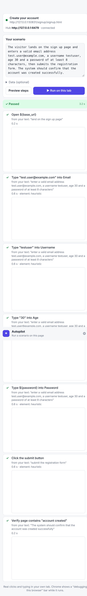
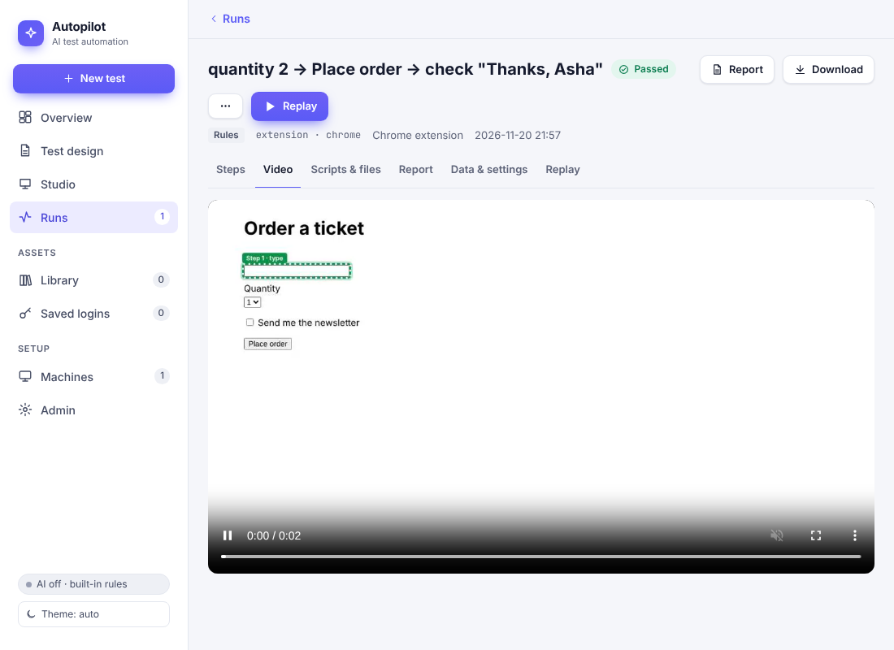

# Chrome extension

Open the website you want to test, paste your scenario, press **Run on this tab**. The scenario runs on the page you have open, with real clicks and typing in your own browser. When the page opens a new tab (a `target="_blank"` link, `window.open`), the run follows it and carries on there.

## Install

1. Start the hub (`./start.sh` or `start.bat`, see [Getting started](getting-started.md)). The extension is the hands; the hub is the brain (it understands the text and ranks elements).
2. Open `chrome://extensions`, turn on **Developer mode**, choose **Load unpacked** and pick the `extension/` folder. (Or build a zip with `python tools/build_extension.py --zip` → `dist/autopilot-extension.zip`.)
3. Pin the extension and click its icon: the side panel opens.
4. If your hub is not at `http://localhost:8000`, or it needs a sign-in, open the gear (**Settings**), enter the address and sign in.

Works in Chrome, Edge and other Chromium browsers (Windows, macOS, Linux). It is tested in real Chromium in CI; try it in your own Chrome and tell us what you find.

## Use

* **The tab is picked for you**: the tab you were last on that is a normal website. Open a different site and the panel switches to it.
* Paste the scenario as a paragraph of business language: no quotes or commas needed. **Preview steps** shows how it was split, what was left out as background and what to double-check. **Run** runs it (a previewed plan is run as shown).
* Passwords and other secrets found in the text are lifted out, masked on the page, in screenshots and in the panel, and never echoed back by the hub. The optional **Data** box takes `key=value` lines (`password*=...` marks a secret).
* **Stop** ends the run at the next step. Closing the panel does not stop it; reopening shows where it is.

## Record a flow, replay it exactly

Switch the panel to **Record a flow**, press **Record on this tab** and use the site like a person would: click, type, choose, tick, press Enter, open links in new tabs. Every action becomes a step as you go, in the same format as a typed scenario.

* **Nothing is guessed from pixels.** The recorder reads the page structure: for each action it stores the element's role, name, label, text, test id and a list of locators (the same fingerprint the Playwright and Selenium engines use), and describes it in English ("Place order button").
* **Replay is the same engine** as a typed scenario. Each step tries the locators recorded for it first. If the page changed and none matches exactly one visible element, it falls back to finding the element by its description (the hub ranks the candidates), like the app's self-healing replay.
* **Passwords** are lifted into data (`${password}`), masked on screen and never stored in the steps. Saving to the hub leaves the secret value out.
* **Edit**: remove a step with ✕ after stopping. **Add a check** while recording ("the page should show …", or highlight text on the page and use **Use selected text**), because a click stream can't tell what the page was supposed to show.
* **New tabs** opened by a recorded tab join the recording and are followed on replay; going back to an earlier tab becomes a "switch to tab" step.
* **Copy as English** gives the steps as plain sentences; **Save to hub** puts them in the library, from where the app runs them (and exports Playwright / Selenium code) like any script; **Replay on this tab** runs them right here. For a repetitive task, record once and run it with data rows in the app.
* **Import a Chrome Recorder file** (DevTools → Recorder → Export → JSON) and it becomes the same steps, with the selectors Chrome recorded as the stored locators and fallbacks.

What it can't do: a video file (webm / mp4) has no page structure in it, so it can't be turned into steps without a vision model; record the flow instead. Scrolling, file uploads and mouse paths aren't recorded.

## Every run is kept on the hub

A run from the panel (typed scenario, recording or replay) is reported to the hub as it happens, and becomes a run like any other there:

* **Live**: it shows in the hub's run list while it runs, and anyone with the hub open sees the steps and the tab's picture update live (the same live view as a run in the app).
* **Evidence**: a screenshot per step, a **video** of the tab (Chrome's screencast of the tab, built into `video.webm`), `report.html`, `summary.json`. A failure is a failed run with the failing step's screenshot, message and video.
* **History and stats**: it counts in the dashboard, the run list, filters and the SQL reporting views (engine `extension`, machine `Chrome extension`).
* **A script you can replay**: `script.json` holds every step with the locators of the element the run actually acted on, plus generated Playwright and Selenium scripts. The first step opens the page the run started on.
* **Secrets** are kept in the hub's vault and masked everywhere else, exactly like an app run. They are in none of the files.
* Turn it off in Settings (**Send runs to the hub**) to run without leaving anything behind. If the hub can't be reached, the run still goes ahead where it can (see below) and just isn't reported.

### Replay: from the app, from the extension

| What | Replay in the app (Playwright / Selenium) | Replay in the extension |
|---|---|---|
| A run from the panel | **Replay** on its run page (or `POST /api/runs {replay_run_id}`) | panel → **From the hub** → Recent runs → ▶ |
| A recording | Save to hub, then run it from the library | panel → **From the hub** → Saved scripts → ▶, or **Replay on this tab** right after recording |

A replay in the app opens the start page and uses the stored locators (re-finding by description if a page changed). A replay in the extension does the same in your own tab. A replay is a run of its own on the hub, linked to the original (`source_run`). A saved script does not keep its secrets: the panel asks for them under Data; a replay of a past run by its owner gets them back from the vault.

Finding an element by its *description* (a typed scenario) needs the hub, which ranks the candidates. Steps that carry a stored locator (recordings, replays) don't, so they still run when the hub is down; they just aren't reported.

## How it follows tabs

The extension watches `tabs.onCreated` (with the opener), `onUpdated` and `onActivated`. When a step opens a tab from the one under test, the run attaches to the new tab, notes it as **Tab 2** in the panel, and later steps run there. Each step shows which tab it ran in.

## What runs where

| Hub (your Autopilot server) | Extension (your browser) |
|---|---|
| Understands the paragraph (`/api/parse`) | Reads the page (every frame) into candidates |
| Ranks elements, optional AI tie-break (`/api/locate`) | Real mouse and keyboard through the Chrome debugger |
| Holds secrets and masking rules | Waits, handles dialogs, takes screenshots, checks page text |

The element finder is generated from the same Python source the Playwright and Selenium engines use (`python tools/build_extension.py`; `--check` fails if the generated files are stale), so the extension finds, boxes and masks the same way.

## Limits

* Chrome shows a "… is debugging this browser" bar while a run is active. That is how real input is sent.
* `chrome://` pages and the Chrome Web Store cannot be automated; `file://` pages need **Allow access to file URLs** on the extension's page.
* Cross-origin iframes (payment widgets): clicks and typing use in-page events there, not trusted browser input.
* Closed shadow roots are only visible if you tick **Open closed shadow roots** in Settings (reload the page after).
* File upload is not supported yet; drag and drop only works where the page listens to mouse events.
* The hub must be reachable from the browser to run a typed scenario (to understand it and rank elements); recorded steps replay without it.
* The video is Chrome's screencast of the tab being tested (about 10 frames a second, 1280×720). It starts with the run, so it shows the run, not the time before it.
* With AI off the paragraph parser is rule based; wording it cannot place is reported as *not understood* instead of guessed.

## Tests

`python -m pytest tests/test_extension.py tests/test_recorder.py tests/test_ext_reporting.py tests/test_extension_reporting.py` loads the extension into real Chromium and covers: a business paragraph on an open page, auto-picking the tab, new tab and popup following, hover, native dialogs, multi-page flows, secrets, cross-origin frames, closed shadow roots, hub sign-in, Stop and the error messages.

`test_extension_reporting.py` also checks, against a real hub: the run, its live events, screenshots, a video whose last frame shows the page, the report, stats, the app replaying the extension's run with Playwright, a recording replayed by the app and the extension, secrets absent from the hub's files, a failure reported as one, reporting off, and a hub that's down.
