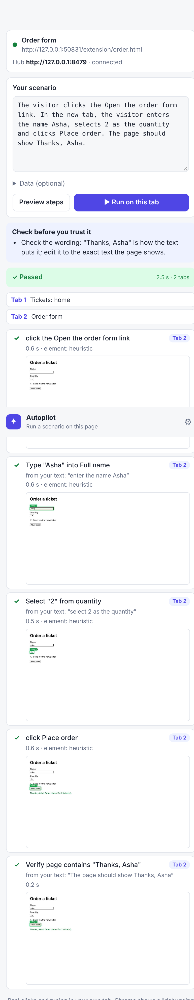
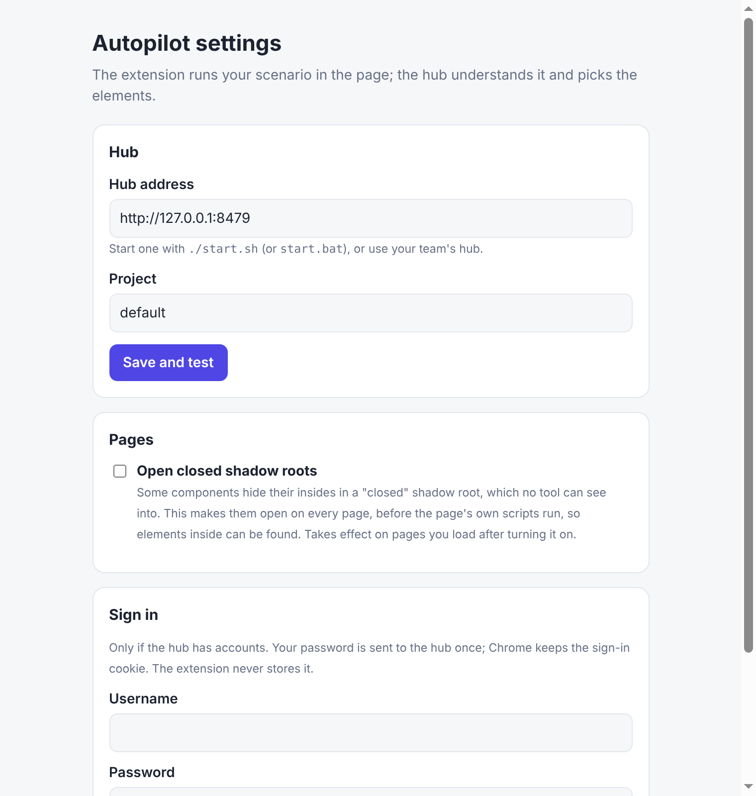
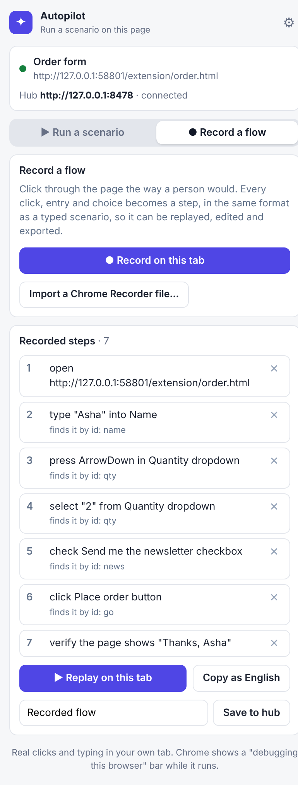

# Chrome extension

The extension is **another way to run the server**. Open the website, paste a scenario (or record a flow) in the extension's side panel, press **Run on this tab**. The hub's own runner and Playwright engine then run it **in your tab**, with your logins, and follow new tabs. It is not a smaller copy of the engine: it is the same engine, so everything the server can do in a test, it does here.



## How it works

```
 side panel ──► hub (parse, plan, queue, report) ──► the server's Runner + Playwright engine
                                                              │  DevTools protocol
 your Chrome tab ◄── extension (a thin bridge: Chrome's debugger API ⇄ WebSocket) ◄──┘
```

* The extension attaches Chrome's debugger to the tab and relays DevTools-protocol messages over a WebSocket to the hub. The hub shows that to Playwright as an ordinary DevTools endpoint (`/cdp/<token>`), so Playwright connects to your tab the way it connects to any browser.
* **Nothing is re-implemented in the extension.** Understanding the text, element finding and ranking, verification, self-healing, scroll search, the AI tie-break and vision fallback, uploads, drag and drop, dialogs, assertions, secrets and masking, reports, scripts: all the server's code.
* Tabs a step opens (target=_blank, `window.open`) are driven too, and the run continues in them.
* The run is a **normal run on the hub** (machine "Chrome extension"): it is in the run list, dashboards, stats and SQL views, has a live view while it runs, a screenshot per step, a **video of the tab**, `report.html`, `script.json`, generated Playwright and Selenium scripts. Secrets stay in the hub's vault.

## Install

1. Start the hub (`./start.sh` or `start.bat`, see [Getting started](getting-started.md)).
2. Open `chrome://extensions`, turn on **Developer mode**, choose **Load unpacked** and pick the `extension/` folder. (Or `python tools/build_extension.py --zip` → `dist/autopilot-extension.zip`.)
3. Pin the extension and click its icon: the side panel opens.
4. If your hub is not at `http://localhost:8000`, or it has accounts, open the gear (**Settings**): enter the address and sign in.



Chrome 126 or newer (Edge and other Chromium browsers work too). Tested in real Chromium in CI on Windows, macOS and Linux.

## Use

* **The tab is picked for you**: the tab you were last on that is a normal website.
* Paste the scenario as a paragraph of business language or as steps. **Preview steps** shows how it was split, what was left out as background and what to double-check. **Run** runs it.
* Passwords and other secrets in the text are lifted out, masked and kept in the vault. The optional **Data** box takes `key=value` lines (`password*=...` marks a secret).
* **Stop** cancels the run. Closing the panel does not stop it; reopening shows where it is.
* Every run links to its page on the hub: live view, steps with screenshots, video, report, replay, export.

## Record a flow, get a script

The point of recording (and of running in the extension) is the **script** you get out: Playwright and Selenium scripts that run on their own, in CI, without this tool. Switch the panel to **Record a flow**, press **Record on this tab** and use the site like a person.



**Everything you do is captured**, in the order you did it:

| You do | It becomes |
|---|---|
| click, double-click, right-click | `click` / `double_click` / `right_click` |
| type in a field, an editor (contenteditable), a date / number field | `type` with the final value |
| move a slider, pick a colour | `type` (set by value) |
| choose from a dropdown (one or several options) | `select` |
| tick / untick a checkbox or radio | `check` / `uncheck` |
| choose a file | `upload` (the file name goes to Data, set its path where the script runs) |
| Enter, Escape, Tab, arrows in widgets, shortcuts (Ctrl+…) | `press` |
| rest the mouse on something that reveals a menu | `hover` (only hovers that revealed something) |
| drag and drop (HTML5 or with the mouse) | `drag` |
| scroll the page | `scroll` |
| answer an alert / confirm / prompt | `dismiss` / `accept` the dialog, plus a check of its message |
| open a link in a new tab, switch back | followed on replay, `switch_tab` when you go back |
| clicks inside iframes (also inside iframes in iframes, and cross-origin ones), inside shadow roots (nested too) | locators that carry the frame and shadow chain |

Each step stores the element's role, name, label, text, test id and a list of locators (the engines' own fingerprint). Passwords are lifted into data (`${password}`), masked and left out when you save. Add a check while recording ("the page should show …", or highlight text and **Use selected text**): a click stream cannot know what the page was supposed to show.

Then: **Check replay** (replays it right now on this tab with the server's engine and marks every step that does not reproduce, with why, before you save), **Replay on this tab**, **Copy as English**, **Save to hub** (the library: run it from the app, export Playwright / Selenium), or import a **Chrome Recorder** file instead (DevTools → Recorder → Export → JSON). A video file (webm / mp4) has no page structure in it, so it can't be turned into steps without a vision model.

### The scripts run on their own

Runs and recordings both end as `script.json` plus generated `test_playwright.py` and `test_selenium.py` (with `autopilot_runtime.py`). They are checked in the test suite by copying them elsewhere and running them as plain scripts, without this tool on their path: the server's whole playground scenario run from the panel, and a full recorded human session on the same page (inputs, upload, hover menu, custom dropdown, dialogs, editor, drag and drop, nested shadow roots and iframes). Selenium scripts keep up to two more verified locators per step and try them in order.

### What happens when a replayed step does not match

The server's runner (the same one in the app and in the extension) works through these layers for every step:

1. the **stored locator**, which must match exactly one element that still fits the step's description;
2. the **fallback locators**; when one works, the element is described again and the script is rewritten with fresh, verified locators (the stale ones go);
3. **late content**: it scrolls and searches for lazy sections and virtualised lists;
4. **heal by description**: it re-finds the element from the step's English description (ranking, plus the AI tie-break if a key is set), verifies new locators and updates the script; the report counts the step as healed;
5. the **visual fallback** for canvas-style UIs (AI);
6. otherwise it **fails clearly**: when it has to pick from a description and two elements tie it says so and never guesses; a check never heals (different text is a finding); missing data fails with a clear message. The step is marked with the closest candidates and a screenshot.

An optional click that was absent when the run happened ("Accept cookies if shown") has no locator, so its script looks for it by its words and clicks it if present.

Tested in `tests/test_replay_strategy.py` (each layer, Playwright and Selenium), `tests/test_extension_check_replay.py`, `tests/test_extension_complex.py` (shadow roots three deep, shadow inside an iframe, an iframe inside a shadow root, the same label in two shadow roots, elements rebuilt on every click, late elements, identical rows) and `tests/test_extension_real_sites.py` (saucedemo checkout, the-internet shadow DOM / nested frames / iframe editor / alerts, selenium.dev shadow root, todomvc, the UI testing playground's dynamic ids and AJAX, and Amazon as far as the network lets it: from some networks Amazon answers searches with 503 or a CAPTCHA, so the full `examples/amazon_cart.txt` is for a machine it likes). Each real-site scenario runs from the panel, its generated Playwright and Selenium scripts run standalone, and the app replays it.

## Replay from the app and from the extension

| What | In the app (Playwright / Selenium) | In the extension |
|---|---|---|
| A run from the panel | **Replay** on its run page, or `POST /api/runs {replay_run_id}` | panel → **From the hub** → Recent runs → ▶ |
| A recording | Save to hub, run from the library | panel → **From the hub** → Saved scripts → ▶, or **Replay on this tab** |

A replay opens the page the run started on, then uses the stored locators. A replay is a run of its own, linked to the original (`source_run`). A saved script does not keep its secrets: the panel asks for them under Data; a past run's owner gets them back from the vault.

## Things to know

* **The hub is needed** (it is the engine). If it runs on another machine, files for uploads must be on that machine.
* Chrome shows a "debugging this browser" bar while a run is active: that is the bridge.
* `chrome://` pages and the Chrome Web Store cannot be driven; `file://` pages need **Allow access to file URLs** on the extension's page.
* Closed shadow roots are visible only if you tick **Open closed shadow roots** in Settings (reload the page after).
* One run per tab at a time; the machine is the one the hub runs on, so a hub on another computer still drives your tab (the connection is outbound from your browser).

## Tests

`tests/test_extension.py` (panel, recorder, sign-in, errors), `tests/test_extension_recorder_scripts.py` (a whole session recorded, run by the app, and its Playwright and Selenium scripts run standalone), `tests/test_extension_server.py` (the server's own playground scenario run from the panel, virtualised lists, live events, screenshots, a video whose last frame shows the page, report, stats, replays by the app and the extension, recordings, secrets absent from the hub's files, failures) and `tests/test_recorder.py`.
