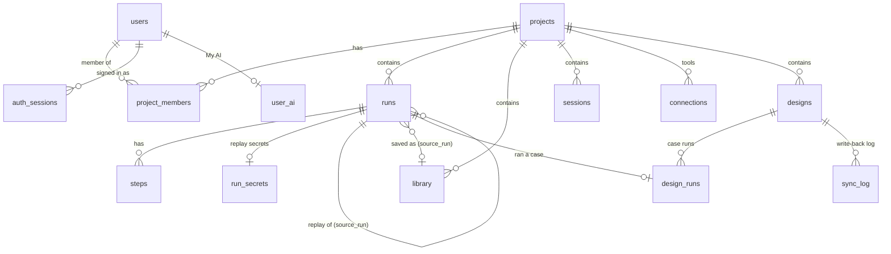

# Database

The hub keeps everything in one **SQLite** file. You can open it with any SQLite tool to report on test results,
build dashboards or export data. This page lists every table, the ready-made reporting views, example queries, and
how to back up, reset or fill it with demo data.

- [Where it is](#where-it-is)
- [Demo data](#demo-data)
- [Opening it](#opening-it)
- [Reporting views (start here)](#reporting-views-start-here)
- [Example queries](#example-queries)
- [Tables](#tables)
- [How the tables relate](#how-the-tables-relate)
- [Back up, move, reset](#back-up-move-reset)
- [Rules for writing to it](#rules-for-writing-to-it)

## Where it is

| File | Default | Set with |
|---|---|---|
| Database | `./aiauto.db` (where you start the hub) | `AIAUTO_DB=/path/to/aiauto.db` |
| Write-ahead log (part of the database while the hub runs) | `aiauto.db-wal`, `aiauto.db-shm` | (follows the database) |
| Encryption key for stored secrets | `./aiauto.key` next to the database | `AIAUTO_SECRET_KEY` (any long string) |
| Run folders (reports, videos, screenshots, scripts) | `./artifacts/<run_id>/` | `AIAUTO_ARTIFACTS` |
| Docker | `/data/aiauto.db`, `/data/artifacts` in the `autopilot-data` volume | |

The database holds metadata, results and paths. Videos, screenshots and reports stay as files under the artifacts
folder: `runs.video` and `steps.screenshot` are paths relative to `artifacts/<run_id>/`.

## Demo data

To get a database full of real data to explore:

```bash
python -m aiauto demo                      # fills ./aiauto.db and ./artifacts (stop the hub first)
python -m aiauto demo --db demo.db --artifacts demo_artifacts   # or into separate files
```

It starts a hub, creates everything through the API and runs the example tests against the practice pages the hub
serves at `/demo/`, so every row is real: reports, videos and generated scripts included. AI is off while it loads,
so it needs no AI account and gives the same result each time. It takes a few minutes.

| You get | Details |
|---|---|
| 3 accounts | `admin`, `tester`, `viewer`, one per role, password `autopilot-demo` (`--password` to choose) |
| 2 projects | **Default** and **Demo shop** (`tester` is a member) |
| 20 runs | Demo shop: the cart test with 2 iterations on Playwright and Selenium, a Script-mode replay, a login test with a masked password, the 52-step element playground. Default: 13 cases from a test design |
| 1 failure, on purpose | The sign-up form accepts age 100. The design's "Rejects Age = 100" case catches it, as a real regression would |
| 2 library scripts | `shop-cart`, `demo-login` |
| 1 test design | From a pasted story (`DEMO-1`), with a Local Git repository connection the design read the form's fields from |

The demo runs point at `http://localhost:8000/demo/...`, so replays work whenever the hub runs on port 8000. If you
use another port, pass the same `--port` to `demo`. It refuses to touch a database that already has accounts unless
you add `--force`.

## Opening it

You can read the database while the hub runs.

- **GUI**: [DB Browser for SQLite](https://sqlitebrowser.org/) (free, Windows/macOS/Linux), DBeaver, DataGrip,
  TablePlus. Open `aiauto.db`, then the *Browse Data* or *Execute SQL* tab.
- **Command line**: `sqlite3 aiauto.db` (preinstalled on macOS and most Linux), then `.tables`, `.schema runs`,
  `.mode box`, and SQL.
- **Python / pandas**:

  ```python
  import sqlite3, pandas as pd
  con = sqlite3.connect("file:aiauto.db?mode=ro", uri=True)          # read-only
  runs = pd.read_sql("SELECT * FROM report_runs", con)
  print(runs.groupby("status").size())
  ```
- **Dashboards**: Metabase, Grafana (SQLite data source plugin), Superset, Power BI / Excel through an SQLite ODBC
  driver. Point them at the file and use the `report_*` views.
- **Without SQL**: the hub's API returns the same data as JSON (`GET /api/runs`, `/api/stats`, `/api/runs/{id}`); see
  [API](api.md).

## Reporting views (start here)

Five read-only views turn the raw tables into readable rows: times as text, durations in seconds, mode as `ai` or
`script`. The hub re-creates them on every start, so they always match the current tables. Prefer them over the raw
tables in reports.

### `report_runs`: one row per run

| Column | Meaning |
|---|---|
| `run_id` | Unique id, also the run's folder name under `artifacts/` |
| `project` | Project key (`default` unless the run was made in another project) |
| `test_name` | Name shown in the app (iterations add `· #2 HP, qty 1 · selenium`) |
| `status` | `queued`, `dispatched`, `running`, `passed`, `failed`, `cancelled`, `interrupted` |
| `mode` | `ai` = first run from the description (with or without AI) · `script` = replay of a generated script |
| `parser` | Who made the steps: `ai`, `rules` (built-in parser), `user` (edited steps), `script` (replay) |
| `engine`, `browser` | `playwright` / `selenium`; `chromium`, `chrome`, `msedge`, `firefox`, `webkit`, `safari` |
| `machine` | Where it ran: `local` (the hub), an agent's name, or a grid's name |
| `owner` | Username of the person who started it (empty with accounts off) |
| `iteration`, `batch_id` | Iteration label; runs started together (iterations × engines × machines, or a design launch) share a batch |
| `replay_of` | For a replay: the run whose script it replayed |
| `created_utc`, `started_at`, `finished_at` | When it was queued (UTC), started and finished (ISO 8601) |
| `duration_s` | Run time in seconds |
| `steps_total`, `steps_passed`, `steps_failed`, `steps_healed` | Step counts; healed = a stored locator was repaired on replay |
| `video` | Video file in the run folder (`video.webm`, or `video.mp4`) |
| `error` | First failing step's error |

### `report_steps`: one row per step of every run

`run_id`, `project`, `test_name`, `engine`, `browser`, `run_status`, `step` (1-based), `status` (`passed`, `failed`,
`skipped`), `instruction` (the step as written), `action` (`navigate`, `click`, `type`, `select`, `check`, `hover`,
`drag`, `assert_text`, …), `target` (the element description), `value` (secrets shown as `••••••`), `locator` (the
native locator used, e.g. `role=button:Login`, `id=qty`, `css=…`), `parsed_by` (`ai`, `rules`, `user`), `picked_by`
(`heuristic`, `ai`, `ai-vision`, `script`, `fallback`), `duration_ms`, `healed` (0/1), `dialog` (text of an alert it
answered), `url`, `screenshot` (path in the run folder), `error`, `run_created_utc`.

### `report_tests`: one row per test name and project

`runs`, `passed`, `failed`, `pass_rate_pct` (of finished runs), `avg_duration_s`, `healed_steps`, `last_run_utc`,
`last_status`. Iterations have their own names, so each iteration is its own row.

### `report_daily`: one row per day and project

`day` (UTC date), `project`, `runs`, `passed`, `failed`, `pass_rate_pct`.

### `report_failures`: one row per failed step

`run_id`, `project`, `test_name`, `engine`, `browser`, `machine`, `created_utc`, `step`, `instruction`, `locator`,
`error`, `screenshot`.

## Example queries

```sql
-- Pass rate per project, last 7 days
SELECT project, SUM(passed) AS passed, SUM(failed) AS failed,
       ROUND(100.0 * SUM(passed) / NULLIF(SUM(passed) + SUM(failed), 0), 1) AS pass_rate_pct
FROM report_daily WHERE day >= date('now', '-7 days') GROUP BY project;

-- Tests that failed their last run
SELECT project, test_name, last_run_utc FROM report_tests WHERE last_status = 'failed' ORDER BY last_run_utc DESC;

-- Flaky tests: both passed and failed in the last 14 days
SELECT test_name, SUM(status = 'passed') AS passed, SUM(status = 'failed') AS failed
FROM report_runs WHERE created_utc >= datetime('now', '-14 days')
GROUP BY test_name HAVING passed > 0 AND failed > 0;

-- The most common failure messages
SELECT substr(error, 1, 120) AS error, COUNT(*) AS times FROM report_failures GROUP BY 1 ORDER BY times DESC LIMIT 10;

-- Slowest steps (where to look when a suite gets slow)
SELECT test_name, step, instruction, duration_ms FROM report_steps
WHERE status = 'passed' ORDER BY duration_ms DESC LIMIT 20;

-- Playwright vs Selenium on the same tests
SELECT engine, COUNT(*) AS runs, ROUND(AVG(duration_s), 1) AS avg_s,
       ROUND(100.0 * SUM(status = 'passed') / COUNT(*), 1) AS pass_rate_pct
FROM report_runs WHERE status IN ('passed', 'failed') GROUP BY engine;

-- Locators repaired by self-healing (worth updating in the app or the test)
SELECT test_name, step, instruction, locator FROM report_steps WHERE healed = 1;

-- How elements were found
SELECT picked_by, COUNT(*) FROM report_steps WHERE picked_by IS NOT NULL GROUP BY picked_by;

-- Who runs what
SELECT owner, COUNT(*) AS runs, SUM(status = 'failed') AS failed FROM report_runs GROUP BY owner;

-- Each machine's load and results
SELECT machine, COUNT(*) AS runs, ROUND(SUM(duration_s) / 60, 1) AS minutes FROM report_runs GROUP BY machine;

-- Every test case of a design with its latest result
SELECT d.issue_key, json_extract(c.value, '$.title') AS case_title, json_extract(c.value, '$.type') AS kind,
       (SELECT r.status FROM design_runs dr JOIN runs r ON r.run_id = dr.run_id
        WHERE dr.design_id = d.id AND dr.case_id = json_extract(c.value, '$.id') ORDER BY r.created DESC LIMIT 1) AS latest
FROM designs d, json_each(d.cases_json) c;
```

Export a view to CSV: `sqlite3 -header -csv aiauto.db "SELECT * FROM report_runs" > runs.csv`.

## Tables

Times stored as numbers (`created`, `updated`, `last_seen`, …) are Unix seconds (UTC): use
`datetime(created, 'unixepoch')`. Columns ending in `_json` hold JSON text: use `json_extract()` / `json_each()`.

### Results

**`runs`**: one row per run.

| Column | Meaning |
|---|---|
| `run_id` (key) | `YYYYMMDD-HHMMSS-<name>-<random>`, also the folder name in `artifacts/` |
| `test_name`, `status`, `engine`, `browser` | As in `report_runs` |
| `agent` | Machine that ran it (`local`, agent or grid name) |
| `mode` | `ai` (first run) or `replay` (Script mode) |
| `parser` | `ai`, `rules`, `user`, `script` |
| `owner`, `project` | Who started it; which project it belongs to |
| `started_at`, `finished_at` | ISO 8601 text |
| `created` | Unix seconds when it was queued (the list order) |
| `duration_ms` | Run time |
| `total`, `done`, `passed`, `failed`, `healed` | Step counters (`done` grows while it runs) |
| `current_step` | The step running now (empty when finished) |
| `video`, `thumb` | Video file and the last screenshot, in the run folder |
| `error` | First failing step's error, or why the run could not start |
| `iteration`, `batch_id` | Iteration label; shared id of runs started together |
| `config_json` | The run's options (`RunConfig`: engine, browser, headless, timeouts, video, …) |
| `data_json`, `sensitive_json` | Test data with secrets masked; the list of sensitive keys |
| `source_run` | The run a replay came from |

**`steps`**: one row per step of a run; key `(run_id, idx)`, `idx` 0-based. Columns: `status`, `raw` (the
instruction), `action`, `target`, `value` (masked), `locator` (label of the native locator), `error`, `screenshot`,
`url`, `duration_ms`, `healed`, `dialog`, `parsed_by`, `picked_by`, `origin` (the sentence of the original description
the step came from).

**`run_secrets`**: `(run_id, secrets_json)`. The real values of a run's sensitive data, encrypted (`enc:…`), so
*Replay with the same data* works. Readable only with the hub's key.

### Tests you keep

**`library`**: saved scripts. `name` (key), `test_name`, `steps` (count), `engine`, `sensitive`, `test_json` (the
full test spec, the same as `script.json`), `source_run`, `owner`, `project`, `created`, `updated`.

**`sessions`**: saved logins. `name` (key), `state_json` (cookies + localStorage in Playwright `storage_state`
format), `domains`, `owner`, `project`, `updated`. These are live login cookies in plain JSON: treat the database file
as sensitive.

### Accounts

**`users`**: `id`, `username` (unique), `name`, `email`, `role` (`admin`, `tester`, `viewer`), `pw_hash` (scrypt; empty
for SSO-only accounts), `sso_issuer`, `sso_sub` (the SSO identity), `disabled`, `created`, `last_login`.

**`auth_sessions`**: who is signed in. `token_hash` (SHA-256 of the cookie; the cookie itself is never stored),
`user_id`, `created`, `expires`. Deleting a user's rows signs them out.

**`user_ai`**: each person's own AI settings (**My AI**), encrypted: `user_id`, `data_enc`, `updated`.

**`projects`**: `key` (e.g. `shop`), `name`, `description`, `created`. `default` always exists.

**`project_members`**: `(project, user_id)`. Admins see every project without being members; everyone sees Default.

**`agent_tokens`**: per-machine tokens. `id`, `label`, `token_hash`, `created`, `created_by`, `last_used`,
`last_machine`, `revoked`.

### Test design and integrations

**`connections`**: one per tool per project: `(project, kind)` key, `kind` (`jira`, `confluence`, `github`,
`local_repo`, `zephyr_scale`, `xray`, `azure_devops`, `custom`), `settings_json` (URLs, project keys, options),
`secrets_enc` (the token, encrypted), `updated`, `updated_by`.

**`designs`**: test designs. `id`, `project`, `issue_key`, `issue_title`, `status` (`draft`, `approved`), `pack_json`
(the context pack: story, criteria, docs, code findings), `cases_json` (the cases: `id`, `title`, `type` positive /
negative / boundary / role / regression, `priority`, `steps`, `data`, `status`, `covers`, `external` ids in the test
tool), `notes_json`, `cycles_json` (test cycles / executions created per launch), `created_by`, `created`, `updated`.

**`design_runs`**: which run executed which case: `run_id`, `design_id`, `case_id`, `launch_id` (one launch = one
"Run" press), `synced` (results sent to the tools), `created`.

**`sync_log`**: everything sent to or read from the tools: `design_id`, `project`, `kind` (tool), `action`, `ok`,
`detail`, `ref` (issue / case / execution id), `at`, `by`.

### The hub

**`machines`**: agents that have connected: `name`, `hostname`, `platform`, `engines`, `browsers` (JSON lists),
`version`, `first_seen`, `last_seen`, `online`.

**`settings`**: hub-wide settings as JSON, `key` → `value_json`: `ai` (organisation AI; keys encrypted), `grids`
(remote browser grids), `sso` (sign-in settings; client secret encrypted).

## How the tables relate



Links are by value (`runs.project` = `projects.key`, `runs.owner` = `users.username`, `steps.run_id` = `runs.run_id`);
SQLite foreign keys are not enforced, so deleting a project in the app moves its work to Default rather than deleting
it.

## Back up, move, reset

- **Back up** the database **and** `aiauto.key` (or keep your `AIAUTO_SECRET_KEY`) and the `artifacts/` folder.
  Without the key, stored tokens and replay secrets can't be decrypted (everything else still works). A consistent
  copy while the hub runs:

  ```bash
  sqlite3 aiauto.db ".backup 'aiauto-backup.db'"
  ```
  Or stop the hub and copy `aiauto.db` (plus `-wal` / `-shm` if they exist).
- **Move** to another machine or into Docker: copy the database, the key and `artifacts/`, then set `AIAUTO_DB`,
  `AIAUTO_ARTIFACTS` (and `AIAUTO_SECRET_KEY` if you used one).
- **Reset**: stop the hub, delete `aiauto.db*` (and `artifacts/` if you want), start again. The first start prints a
  new setup code. Keep `aiauto.key` if you restore an old backup later.
- **Clean up old runs**: delete them in the app (Runs → select → Delete), which removes the folder too. With SQL:
  `DELETE FROM steps WHERE run_id IN (…); DELETE FROM runs WHERE …;` then delete the matching folders in `artifacts/`.
  The hub re-imports any run folder that has no row, so delete both.
- **Upgrades** add columns and views by themselves on start; nothing to run.

## Rules for writing to it

Read as much as you like. Write only with the hub stopped, or through the API: the hub caches some state (connected
machines, the run queue) and writes run events on its own thread. Never edit `pw_hash`, `token_hash` or the `enc:`
values by hand; use Admin → Users and the API.
