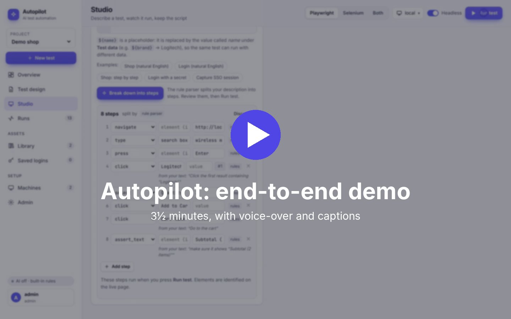

# End-to-end demo (voice-over)

A 3½-minute walkthrough of the whole product, narrated, with captions: writing a test in plain English, running it
live, the run's report, video and scripts, replay, data-driven runs on both engines across two machines, test design
from a user story catching a real bug, machines and agents, and the team features.

[](media/demo/e2e-demo.mp4)

**[▶ Play the demo (MP4, 3:39, 6 MB)](media/demo/e2e-demo.mp4)** · captions: [WebVTT](media/demo/e2e-demo.vtt) ·
[SRT](media/demo/e2e-demo.srt) · shorter clips per feature: [feature tour](features.md)

Everything in it is real: a hub with the [demo data](database.md#demo-data) (`./setup.sh --demo`), AI off, one agent
connected, and every run on screen actually ran.

## Chapters

| At | Chapter | More |
|---|---|---|
| 0:00 | What Autopilot is | [architecture](architecture.md) |
| 0:17 | Sign in and the overview | [user guide](user-guide.md#the-pages) |
| 0:27 | Write a test in plain English | [user guide](user-guide.md#writing-tests) |
| 0:43 | How it was understood | [user guide](user-guide.md#writing-tests) |
| 0:54 | Run it live | [user guide](user-guide.md#running-engines-browsers-machines-options) |
| 1:09 | The run: steps, video, scripts, report | [user guide](user-guide.md#reading-a-run) |
| 1:26 | Replay the generated script | [user guide](user-guide.md#replay-self-healing-and-the-library) |
| 1:44 | Data-driven, both engines, two machines | [user guide](user-guide.md#test-data-iterations-and-secrets) |
| 2:01 | Design test cases from a user story | [integrations](integrations.md) |
| 2:19 | A bug caught | [integrations](integrations.md#how-cases-are-designed) |
| 2:40 | Machines and agents | [deployment](deployment.md#installing-an-agent) |
| 2:59 | Teams: accounts, SSO, projects, integrations, AI | [user guide](user-guide.md#accounts-roles-and-projects) |
| 3:19 | What you keep | [user guide](user-guide.md#generated-scripts-and-exported-projects) |

## Transcript

**0:00 · What Autopilot is.** This is Autopilot, a test automation platform. In the next few minutes we'll go end to end: write a test in plain English, run it on Playwright and Selenium, replay the script it generates, design test cases from a user story, and run everything across machines.

**0:17 · Sign in and the overview.** Everything happens in the web app. After signing in, the overview shows the pass rate, what needs attention, what is running right now, and recent runs.

**0:27 · Write a test in plain English.** In Studio, we describe a test the way we would explain it to a colleague. No code and no selectors. Open the shop, search for a wireless mouse, open the first Logitech result, add two to the cart, and check the subtotal.

**0:43 · How it was understood.** Break down into steps shows exactly how it was understood: one action per step, the element described in words, and the value it will use. You can edit the steps before running.

**0:54 · Run it live.** Now we run it. The browser streams into the page live. Each element is found on the live page, outlined in green, and acted on with a native Playwright locator. Every step gets a screenshot, and the locator that found it.

**1:09 · The run: steps, video, scripts, report.** Every run has its own page. The steps with their screenshots. The video recording. The generated Playwright and Selenium scripts, with the whole run folder. A single file HTML report. And the data and settings that were used.

**1:26 · Replay the generated script.** Replay runs the generated script in script mode. There is no parsing and no AI, just the stored native locators, so it is fast. If the page has changed and a locator breaks, the engine heals it and writes a new script. Here we replay on Selenium instead.

**1:44 · Data-driven, both engines, two machines.** Tests are data driven. Placeholders in the test take their values from a grid, one row per run, and each row can use its own browser. We choose both engines, and share the work between the hub and a remote agent. One click, four runs in parallel.

**2:01 · Design test cases from a user story.** Autopilot can also write the tests. Paste a user story, or pick one from Jira. It reads the acceptance criteria and the code behind them, here a Git commit for the sign up form, and designs positive, negative and boundary cases, with rules alone. No AI needed.

**2:19 · A bug caught.** All thirteen cases were approved and run. One failed. The form accepts an age of one hundred, but the story says eighteen to ninety nine. The run shows the failing step, what was expected, and the page at that moment. Results can go back to Zephyr, Xray and Jira, including a bug with the screenshot.

**2:40 · Machines and agents.** Tests run wherever you need them. The hub runs tests itself, and any Windows, Mac, Linux or Docker machine joins as an agent with one command and its own token. Agents connect out to the hub, so they work behind firewalls. Cloud grids such as BrowserStack plug in the same way.

**2:59 · Teams: accounts, SSO, projects, integrations, AI.** For teams, there are accounts and roles, company single sign on, projects that keep each team's work apart, tokens for Jira, GitHub and test tools, and the AI of your choice: your Claude, Copilot or Cursor subscription, an API key, or none at all.

**3:19 · What you keep.** Everything Autopilot produces is yours. Plain Playwright and Selenium scripts. An exported project that runs in any CI without the hub. And every result in a SQLite database, with reporting views. Set it up with one command, and find the full guide in the docs folder.

## How it is made

The demo is generated, so it can be re-made after the UI changes (`tools/demo_video/`):

1. `voice.py`: the narration (`narration.py`, one entry per scene) spoken by an offline neural voice
   ([Piper](https://github.com/rhasspy/piper), *lessac* voice): one WAV per scene, nothing sent to an online service.
2. `record.py`: Playwright signs in to a demo hub and performs each scene in real time (a visible pointer shows each
   click), holding every scene until its narration ends, while Chrome's screencast captures the screen.
3. `build.py`: frames → video, each scene's voice placed at its start, captions timed sentence by sentence and burned
   in, plus `.vtt` / `.srt` files.

```bash
./setup.sh --demo && ./start.sh                                # a demo hub on :8000
./agent.sh --server http://localhost:8000 --token <token> --name lab-linux --slots 2    # the agent in the iterations scene
cd tools/demo_video
pip install piper-tts && python voice.py en_US-lessac-high.onnx
python record.py && python build.py ../../docs/media/demo
```
