# All diagrams

Every block diagram of Autopilot in one place. GitHub draws them; the prose around each lives in the linked guide.

| | | |
|---|---|---|
| [1. System context](#1-system-context) | [8. Scheduling: which machine runs it](#8-scheduling-which-machine-runs-it) | [15. Secrets: where they go](#15-secrets-where-they-go) |
| [2. Inside the hub](#2-inside-the-hub) | [9. One click, many runs](#9-one-click-many-runs) | [16. Test design and write-back](#16-test-design-and-write-back) |
| [3. Deployment modes](#3-deployment-modes) | [10. Finding the element for a step](#10-finding-the-element-for-a-step) | [17. Data model](#17-data-model) |
| [4. Network and ports](#4-network-and-ports) | [11. Replay and self-healing](#11-replay-and-self-healing) | [18. From description to portable script](#18-from-description-to-portable-script) |
| [5. Agent: install, connect, run](#5-agent-install-connect-run) | [12. Which AI answers](#12-which-ai-answers) | [19. Live view: how frames reach you](#19-live-view-how-frames-reach-you) |
| [6. Life of a run](#6-life-of-a-run) | [13. Sign-in and SSO](#13-sign-in-and-sso) | [20. CI pipelines](#20-ci-pipelines) |
| [7. Run states](#7-run-states) | [14. Who sees what: roles and projects](#14-who-sees-what-roles-and-projects) | |

## 1. System context

Who and what Autopilot talks to. ([Architecture](architecture.md))

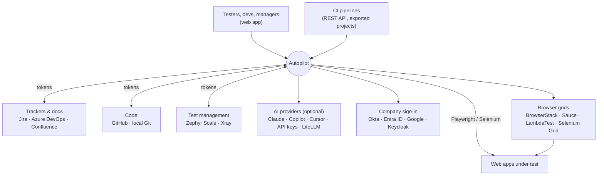

## 2. Inside the hub

The parts of the hub process and what each holds. ([Architecture → The parts](architecture.md#the-parts))

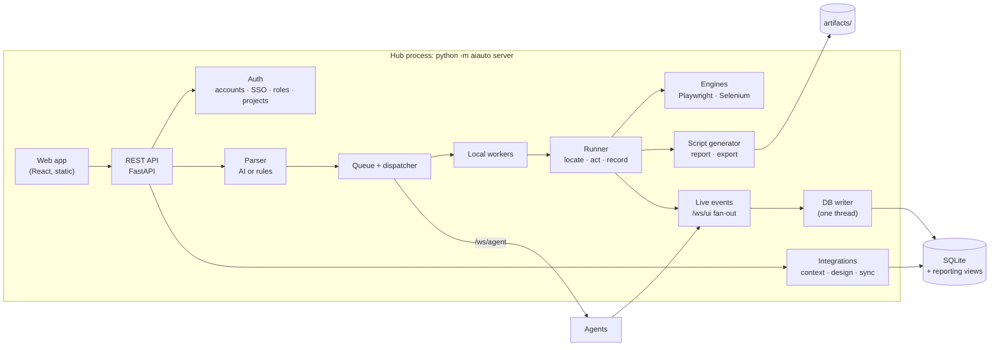

## 3. Deployment modes

From one laptop to a hub with agents and grids. ([Deployment](deployment.md))

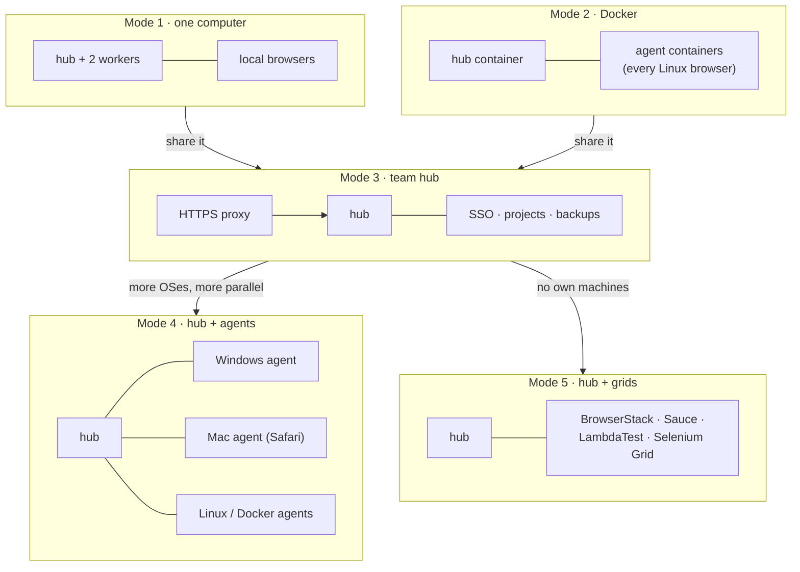

## 4. Network and ports

Everything connects to the hub; nothing connects to an agent. ([Deployment → Network](deployment.md#network-and-ports))

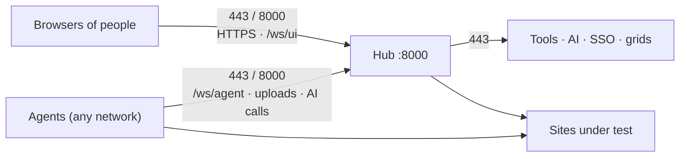

## 5. Agent: install, connect, run

([Deployment → Installing an agent](deployment.md#installing-an-agent))

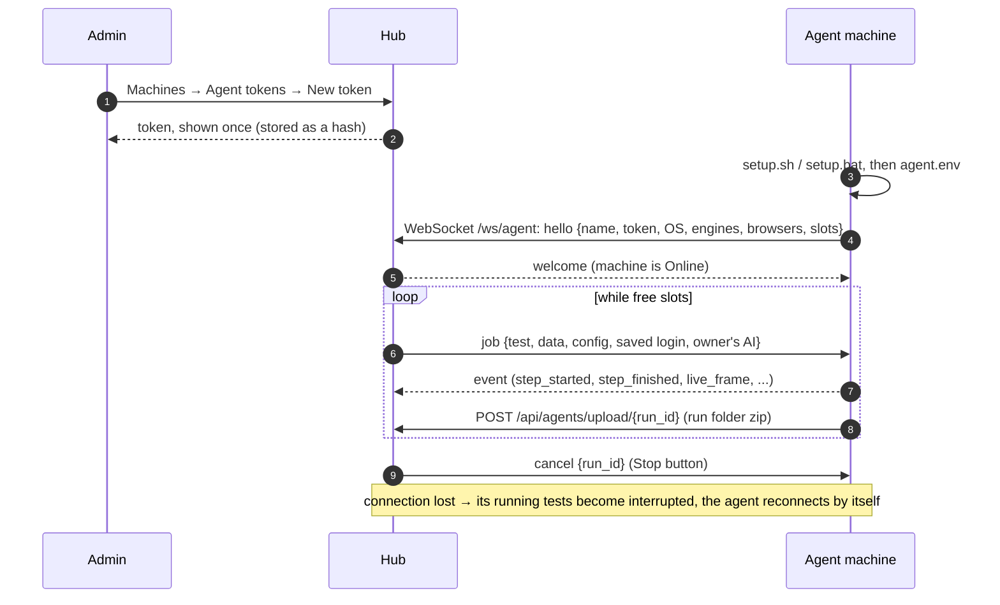

## 6. Life of a run

([Architecture → Life of a run](architecture.md#life-of-a-run))

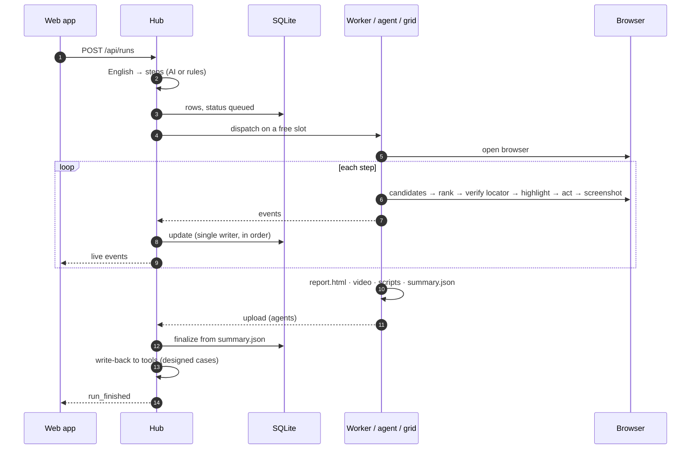

## 7. Run states

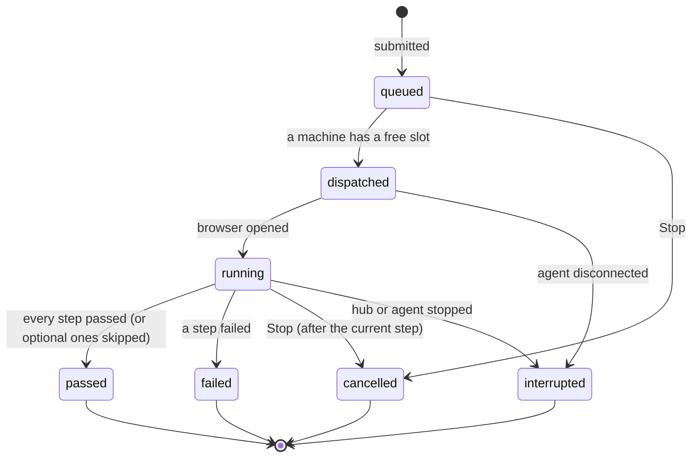

## 8. Scheduling: which machine runs it

([Machines → Parallel runs](machines.md#parallel-runs))

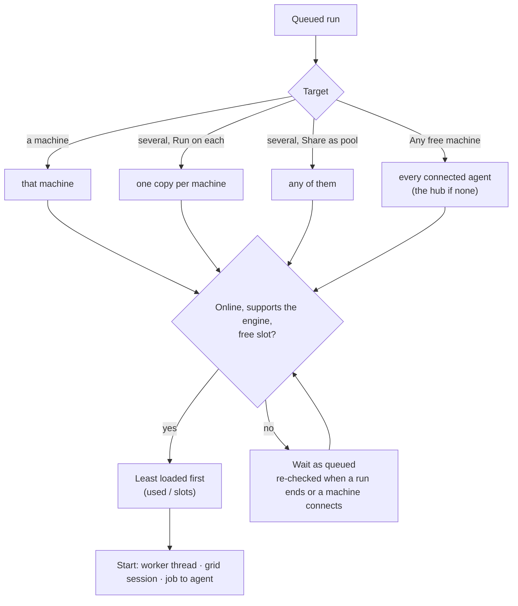

## 9. One click, many runs

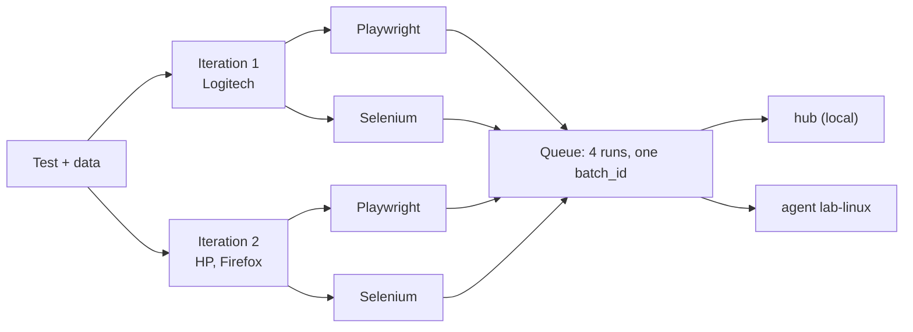

## 10. Finding the element for a step

([Architecture → Finding the element](architecture.md#finding-the-element-for-a-step))

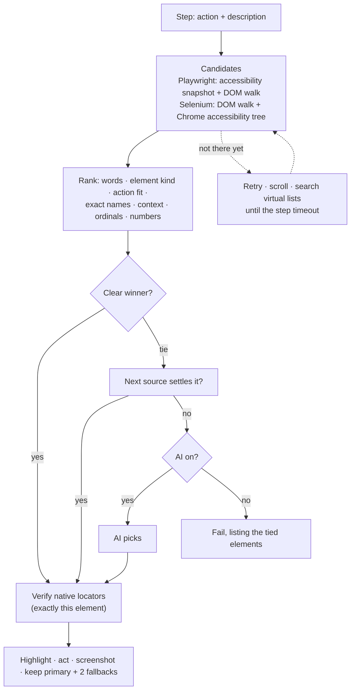

## 11. Replay and self-healing

([User guide → Replay](user-guide.md#replay-self-healing-and-the-library))

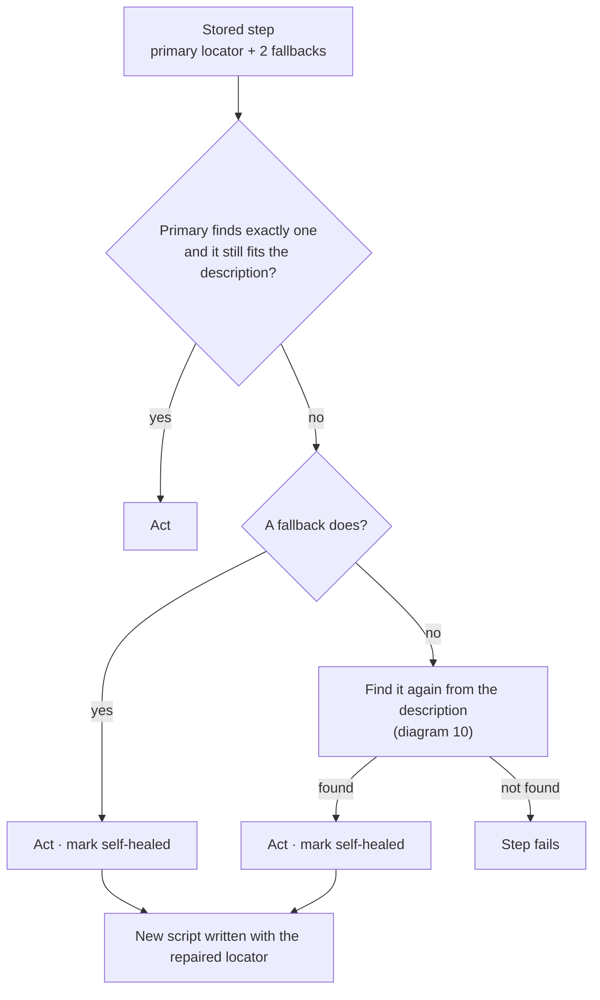

## 12. Which AI answers

([Architecture → AI](architecture.md#ai-where-it-is-used-and-where-it-is-not))

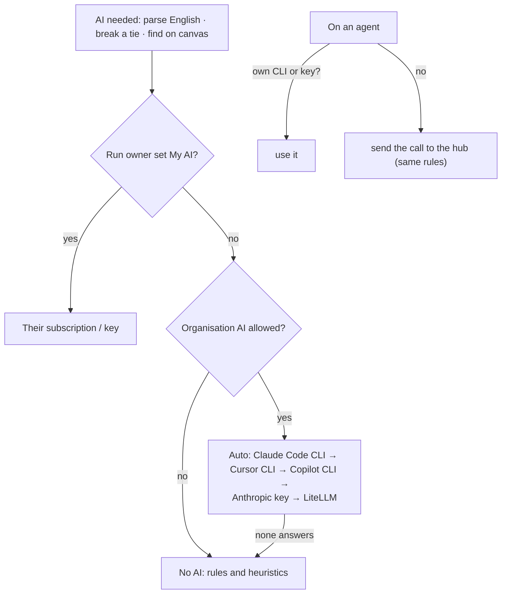

## 13. Sign-in and SSO

([User guide → Accounts](user-guide.md#accounts-roles-and-projects))

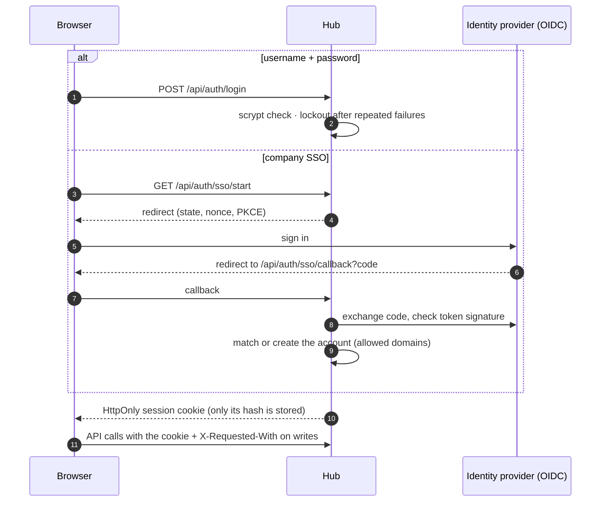

## 14. Who sees what: roles and projects

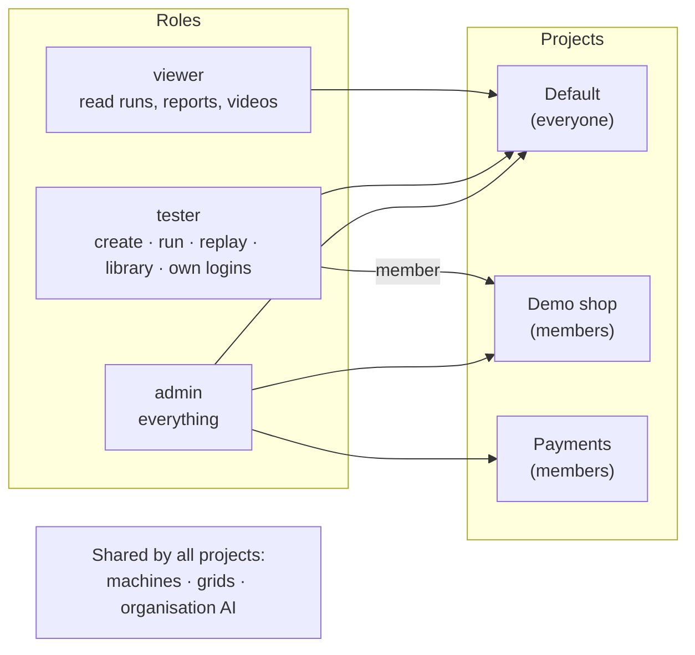

## 15. Secrets: where they go

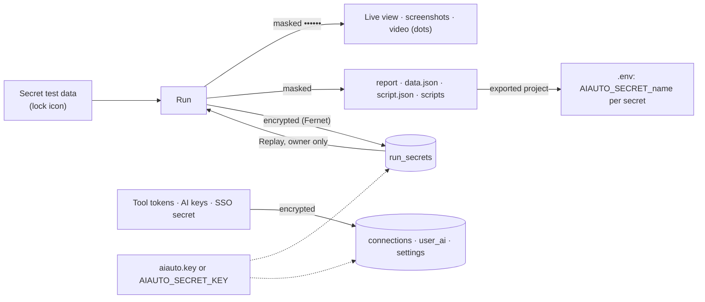

## 16. Test design and write-back

([Integrations](integrations.md))

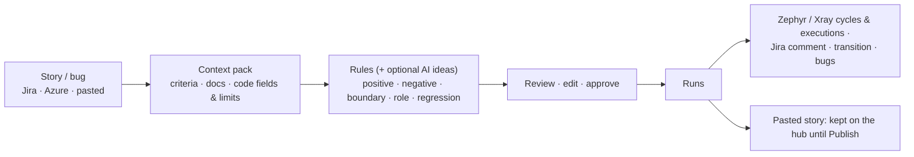

## 17. Data model

([Database](database.md))

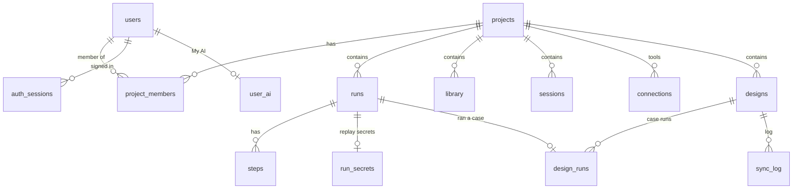

## 18. From description to portable script

([Architecture → First run, replay, script, project](architecture.md#first-run-replay-generated-script-exported-project))

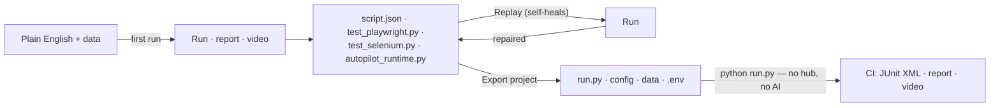

## 19. Live view: how frames reach you

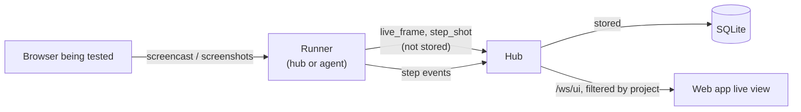

## 20. CI pipelines

([Development → CI](development.md#ci))

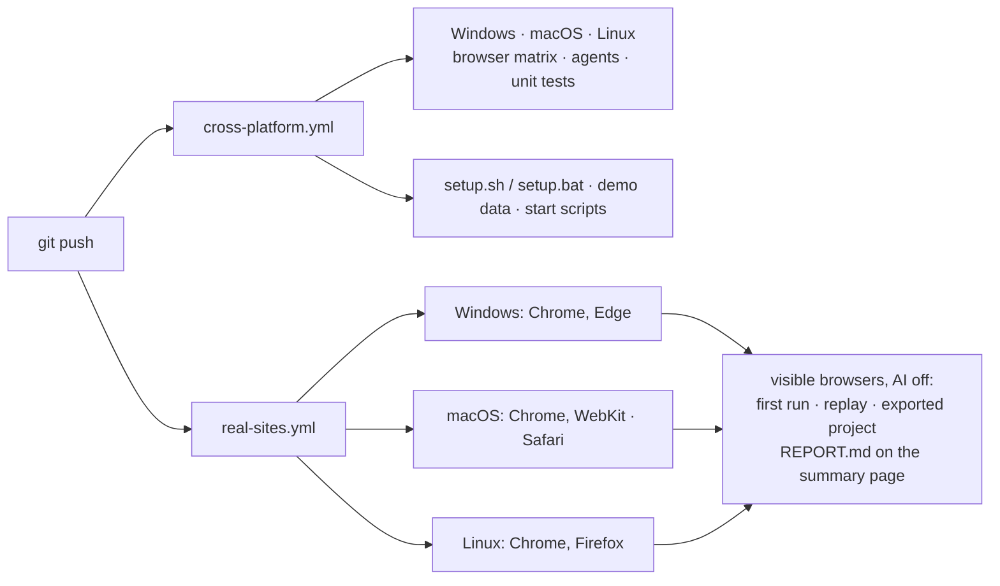
