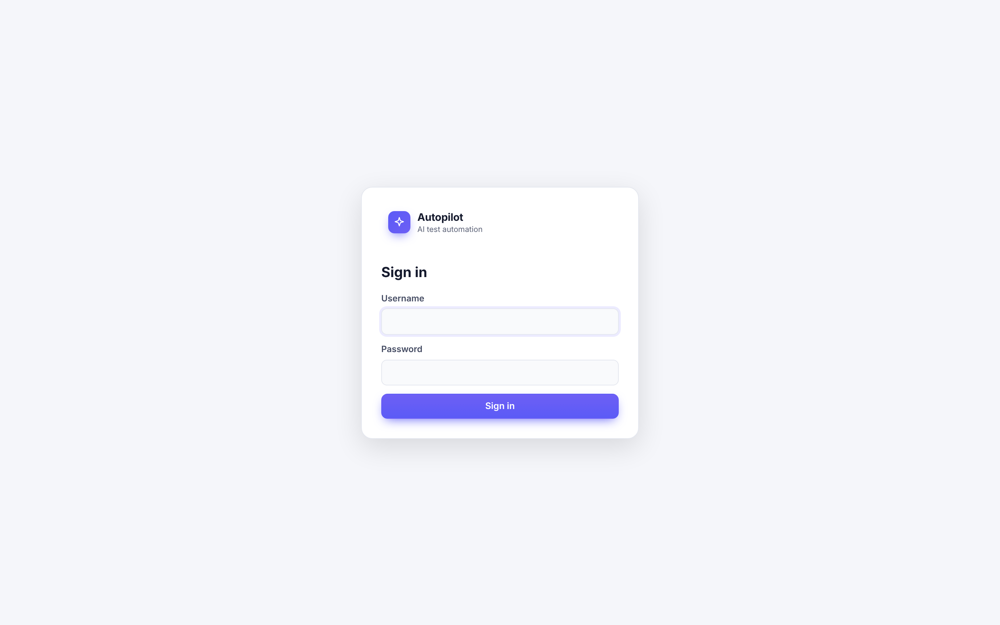
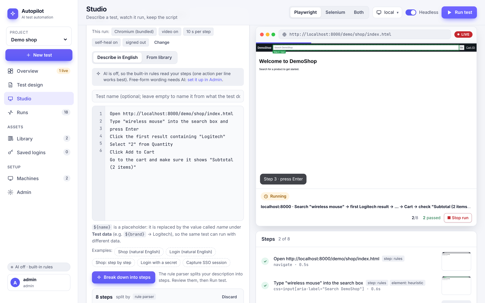
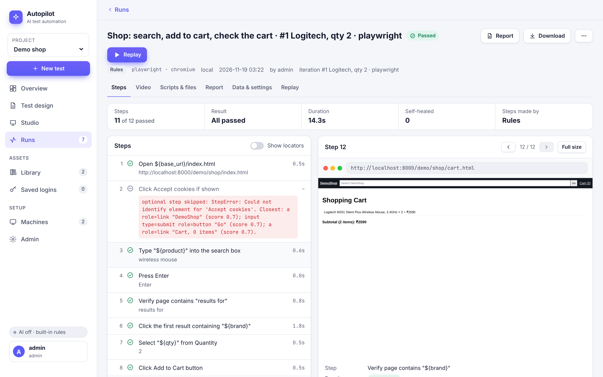

# Getting started

From nothing to your first test run in about ten minutes.

- [What you need](#what-you-need)
- [1. Install](#1-install)
- [2. Start the hub and sign in](#2-start-the-hub-and-sign-in)
- [3. Your first test](#3-your-first-test)
- [4. Replay it, keep the script](#4-replay-it-keep-the-script)
- [5. Optional: turn on AI](#5-optional-turn-on-ai)
- [6. Optional: more machines, your team, your tools](#6-optional-more-machines-your-team-your-tools)
- [Updating](#updating)

## What you need

| | Needed for | Notes |
|---|---|---|
| **Python 3.11 – 3.13** | everything | [python.org/downloads](https://www.python.org/downloads/). On Windows tick *Add python.exe to PATH* |
| A browser | running tests | Setup downloads Playwright's Chromium. For Selenium, the Chrome, Edge or Firefox you already have works: Selenium fetches the matching driver itself |
| Git | optional | Only for the demo's test design and the *Local Git repository* integration |
| Node.js 20+ | optional | Only to change the web app's source (`web/`); the built app ships with the package |
| Docker | optional | Instead of Python, see [option C](#option-c-docker) |

Works on Windows 10/11, macOS (Intel and Apple silicon) and Linux. 4 GB RAM is enough for two tests at a time;
each extra parallel browser needs about 0.5–1 GB.

## 1. Install

### Option A: one step (recommended)

Download or clone the repository, open a terminal in its folder, then:

**macOS / Linux**

```bash
./setup.sh --demo
```

**Windows** (Command Prompt or PowerShell)

```bat
setup.bat --demo
```

This creates a private Python environment in `.venv`, installs the packages and Playwright's Chromium, and with
`--demo` fills the database with [demo data](database.md#demo-data): accounts, two projects and twenty real runs
with reports and videos. Leave out `--demo` to start empty. Add `--all-browsers` for Playwright's Firefox and WebKit
too.

On a fresh Linux machine a browser may need system libraries: `sudo .venv/bin/python -m playwright install-deps`.

### Option B: by hand

```bash
python -m venv .venv
source .venv/bin/activate            # Windows: .venv\Scripts\activate
pip install -r requirements.txt
python -m playwright install chromium
python -m aiauto demo                # optional: demo data
```

### Option C: Docker

```bash
docker compose up --build            # hub on http://localhost:8000 plus one agent with every Linux browser
```

The image contains Chromium, Chrome, Edge, Firefox and WebKit with their drivers and a virtual screen for headed runs.
Data lives in the `autopilot-data` volume. More in [Machines and Docker](machines.md#docker).

## 2. Start the hub and sign in

```bash
./start.sh            # Windows: start.bat      (or: python -m aiauto server --port 8000)
```

Open **http://localhost:8000**.

- **With demo data**: sign in as `admin` / `autopilot-demo`. `tester` and `viewer` use the same password, so you
  can see what each role can do.
- **Without demo data**: the hub prints a one-time **setup code** in its window
  (`No users yet ... setup code: 1a2b3c-...`). Enter it in the web app and create your admin account.


- **Just you, no accounts**: start with `AIAUTO_AUTH=off` (Windows: `set AIAUTO_AUTH=off`) and there is no sign-in.

Change the demo passwords before anyone else can reach the hub (Admin → Users).

## 3. Your first test

The hub serves practice pages at **http://localhost:8000/demo/**: a shop, a sign-up form, a login app and an
element playground.

1. Open **Studio**.
2. Type a test in plain English:

   ```
   Open http://localhost:8000/demo/shop/index.html
   Type "wireless mouse" into the search box and press Enter
   Click the first result containing "Logitech"
   Select "2" from Quantity
   Click Add to Cart
   Go to the cart and make sure it shows "Subtotal (2 items)"
   ```
3. Press **Break down into steps** to see how it was understood (optional), then **Run**.
4. Watch it live: the browser streams into the page, each element gets a green box, and each step gets its
   screenshot and the native locator that found it.



Make it data-driven: write `${brand}` instead of `Logitech`, then under **Test data → Iterations** add one row per run
(Logitech, HP). Each row becomes its own run, and each row can use a different browser. Tick **Engine: Both** to run
every row on Playwright and Selenium.

More in the [User guide](user-guide.md#writing-tests).

## 4. Replay it, keep the script

Open the run (**Runs** → the row). You get:

- **Overview**: every step with its screenshot · **Video** · **Report** (one HTML file) · **Code & files**: the
  generated `test_playwright.py` and `test_selenium.py`.
- **Replay**: runs the generated script in Script mode. It is faster and needs no AI. If the page changed, it heals
  the locator and writes a new script.
- **Export project**: a zip that runs on any machine with Python, with no hub and no AI:

  ```bash
  cd my-test && pip install -r requirements.txt && python -m playwright install chromium
  python run.py                                    # every iteration, with its recorded engine and browser
  python run.py --engine selenium --browser firefox --headed
  ```
- **Save to library** to reuse it later on any engine or machine.



## 5. Optional: turn on AI

Everything above works without AI: the built-in rules parse the test and heuristics find the elements. AI helps with
free-form descriptions, picks between look-alike elements, and finds controls drawn on a canvas.

The easiest way is a subscription you are already logged into on the hub machine: install
[Claude Code](https://claude.com/claude-code) and run `claude` once to log in (or the Cursor or GitHub Copilot CLI).
Or paste an API key under **Admin → Organisation AI** (Anthropic, or any model through LiteLLM). Each person can also
use their own under **My AI** (user menu). Press **Test connection** to check.

## 6. Optional: more machines, your team, your tools

- **Run on Windows, macOS or more Linux boxes**: on that machine, install as above, then
  `./agent.sh --server http://HUB:8000 --token <token> --slots 2` (Windows: `agent.bat ...`). Make the token under
  **Machines → Agent tokens**. Autostart and Docker agents: [Deployment](deployment.md#installing-an-agent).
- **Your team**: host the hub on a server, add people under **Admin → Users** or connect company SSO under
  **Admin → Sign-in**, and split work into **projects**. See [User guide → Accounts](user-guide.md#accounts-roles-and-projects).
- **Jira, Confluence, GitHub, Zephyr Scale, Xray, Azure DevOps**: write test cases from stories and send results back.
  See [Integrations](integrations.md).
- **Reports from the data**: the SQLite database has ready-made reporting views. See [Database](database.md).

## Updating

```bash
git pull
./setup.sh            # Windows: setup.bat   (re-installs packages; keeps your database and runs)
```

The database upgrades itself on the next start. Back up `aiauto.db`, `aiauto.key` and `artifacts/` first if you
care about them ([how](database.md#back-up-move-reset)).

See everything it can do in the [feature tour](features.md). If something doesn't work, see [Troubleshooting](troubleshooting.md).
